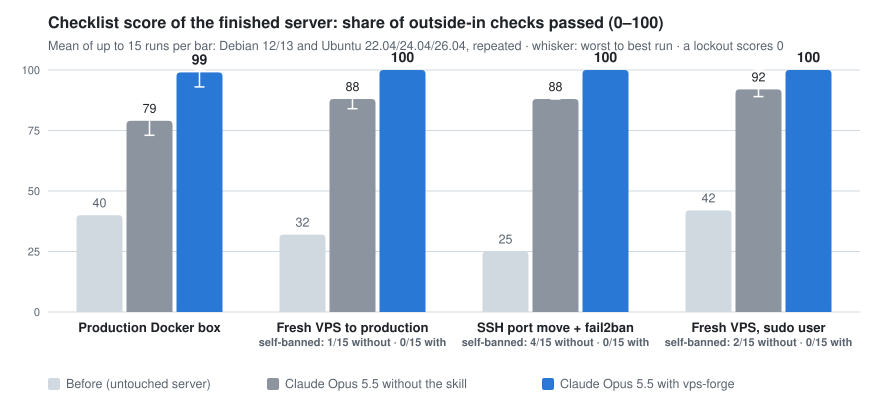
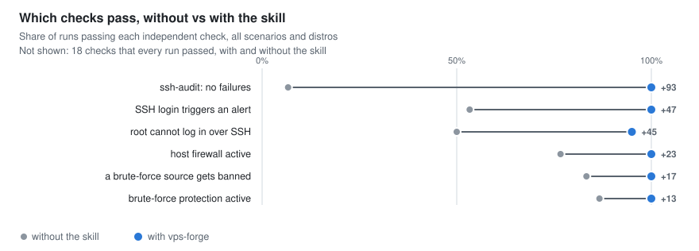
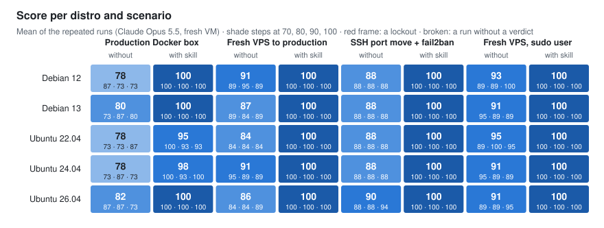
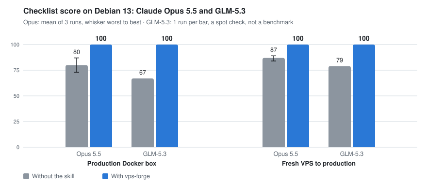

<p align="center">
  <picture>
    <source media="(prefers-color-scheme: dark)" srcset="docs/assets/banner-dark.svg">
    
  </picture>
</p>

<p align="center">
  <b>Ask your AI coding agent to set up a server, and get one you'd trust with production.</b><br>
  An open <a href="https://agentskills.io">Agent Skill</a> for Debian and Ubuntu VPS setup, hardening and audits.<br>
  Works with Claude Code, Codex, Cursor, GitHub Copilot, Gemini CLI, OpenCode and other agents that read skills.
</p>

<p align="center">
  <a href="https://github.com/mountain-beaver/vps-forge/releases/latest"></a>
  <a href="https://github.com/mountain-beaver/vps-forge/actions/workflows/ci.yml"></a>
  <a href="LICENSE"></a>
  <a href="https://agentskills.io"></a>
  
</p>

<p align="center">
  <a href="#quick-start">Quick start</a>&nbsp;&nbsp;&nbsp;
  <a href="#what-you-say-what-you-get">Examples</a>&nbsp;&nbsp;&nbsp;
  <a href="#every-risky-change-has-an-automatic-undo">Safety</a>&nbsp;&nbsp;&nbsp;
  <a href="#benchmark">Benchmark</a>&nbsp;&nbsp;&nbsp;
  <a href="#faq">FAQ</a>
</p>

You rented a VPS, and your agent can already SSH into it and get your app running. What it usually skips is the part you'd only notice later: SSH crypto that fails a scan, a firewall that was never turned on, fail2ban that bans nobody, no alert when someone logs in. Or it tests its own login too eagerly and gets your IP banned.

vps-forge teaches the agent to do the whole job, in the right order, with a safety net under every risky step. The server ends up locked down, backed up, monitored and documented, and every change that could cut you off rolls itself back unless you can still log in.

<p align="center">
  <picture>
    <source media="(prefers-color-scheme: dark)" srcset="docs/bench/hero-dark.svg">
    
  </picture>
</p>

<p align="center"><sub>120 runs of Claude Opus 5.5 on real VMs, the same prompts with and without the skill, scored from outside the server by a separate judge written by the same author. This is a checklist score, not a general security index, and about 70% of the gap comes from three checks that match the skill's own defaults. A run with the skill costs about 3× as much. A four-run spot check of GLM-5.3 shows the same pattern: 67–79 without the skill, 100 with it. <a href="#benchmark">How it was measured, and its limits</a>.</sub></p>

## See it work

<p align="center">
  <picture>
    <source media="(prefers-color-scheme: dark)" srcset="docs/assets/replay-dark.svg">
    
  </picture>
</p>

## Quick start

**1. Install the skill** for whichever agent you use. One command covers most of them:

```bash
npx skills add mountain-beaver/vps-forge
```

It asks which agents to install for. Add `-g` to install for your user rather than the current project. The command comes from the open [`skills`](https://github.com/vercel-labs/skills) installer and needs Node.js.

**2. Talk to your agent about your server.** You don't need special words:

> I just bought a VPS at 203.0.113.10, I log in as root. Make it a proper production server for my Docker app on app.example.com, with backups and alerts to my phone.

The agent picks up the skill, asks up to four short questions, shows a plan and works through it phase by phase.

> [!IMPORTANT]
> **Before you point it at a server you care about:** take a provider snapshot, and find your provider's web console (VNC or serial). The agent checks that you know where the console is before its first risky step. If a change cuts off SSH, the [dead-man switch](#every-risky-change-has-an-automatic-undo) rolls it back within five minutes, and the console covers everything else. First time? Try it on a throwaway box.

<details>
<summary><b>Claude Code</b>: install as a plugin</summary>

```bash
claude plugin marketplace add mountain-beaver/vps-forge
claude plugin install vps-forge@vps-forge
```

Inside a session you can do the same with `/plugin marketplace add mountain-beaver/vps-forge`, then pick it in `/plugin`. To update later, run `claude plugin marketplace update vps-forge`.
</details>

<details>
<summary><b>Codex, Cursor, GitHub Copilot, Gemini CLI, Antigravity, OpenCode, Windsurf, Cline, Amp, Roo</b>: one agent at a time</summary>

Pass the agent to the installer, and `-g` for a user-wide install:

```bash
npx skills add mountain-beaver/vps-forge -g -a codex
```

| Agent | `-a` value |
|---|---|
| Codex | `codex` |
| Cursor | `cursor` |
| GitHub Copilot | `github-copilot` |
| Gemini CLI | `gemini-cli` |
| Antigravity | `antigravity` |
| OpenCode | `opencode` |
| Windsurf | `windsurf` |
| Cline | `cline` |
| Amp | `amp` |
| Roo Code | `roo` |

The full list of about 80 agents is in the installer's [agent table](https://github.com/vercel-labs/skills/blob/main/docs/agents.md).
</details>

<details>
<summary><b>GitHub CLI</b>: <code>gh skill install</code></summary>

```bash
gh skill install mountain-beaver/vps-forge vps-forge --agent cursor --scope user
```

`--agent` takes names such as `claude-code`, `codex`, `cursor`, `github-copilot`, `gemini-cli` and `opencode`; `gh skill install --help` lists them all. Pin a release with `--pin v1.0.0`.
</details>

<details>
<summary><b>Claude.ai and Claude Desktop</b>: upload a zip</summary>

Download `vps-forge-skill.zip` from the [latest release](https://github.com/mountain-beaver/vps-forge/releases/latest) and upload it under Settings → Capabilities → Skills → "Upload skill". Code execution has to be on.

A chat app can't SSH into your server, so there the skill works in **script mode**. It writes a guarded `setup.sh` and tells you exactly how to run it and how to check the result.
</details>

<details>
<summary><b>Any other agent</b>: copy the folder</summary>

```bash
git clone https://github.com/mountain-beaver/vps-forge
mkdir -p ~/.agents/skills && cp -r vps-forge/skills/vps-forge ~/.agents/skills/   # or your agent's skills folder
```

If your agent doesn't support skills at all, tell it to read `skills/vps-forge/SKILL.md` and follow it. The skill is plain Markdown and bash.
</details>

## What you say, what you get

| You say | The agent does |
|---|---|
| "Put my Docker app on this new VPS, with HTTPS." | Admin user with your key, root and passwords off, firewall with 22/80/443 only, Caddy with TLS, tested backups, alerts. |
| "Audit my server. Change nothing." | A read-only report ranked by severity, and a plan. |
| "Move SSH to 2222 and add fail2ban. Nothing else." | Exactly that, done safely, and a one-line offer of the rest. |
| "Send alerts to my phone." | ntfy, Telegram or webhook alerts for logins, failures, full disks and backups. |
| "SSH only through Tailscale." | Public SSH closes only after a VPN login works. |
| "Is my server hacked?" | A compromise check. If it finds signs, it stops and guides a rebuild. |

## What you end up with

| Area | On the finished server |
|---|---|
| **Access** | An admin user that holds only your key. Root and password logins are off, `AllowGroups` is set, and SSH crypto is modern and version-aware, so it passes `ssh-audit`. |
| **Firewall** | ufw or nftables, default deny, with IPv4 and IPv6 matched. Docker-published ports are covered too, and your own IP always gets through first. |
| **Intrusion** | fail2ban with the systemd backend and a recidive jail, with your IP on its ignore list before it ever starts. CrowdSec at the paranoid level. |
| **Updates** | Unattended security updates, needrestart, and an optional reboot window. |
| **Web and apps** | Docker bound to localhost, Caddy or nginx with TLS and security headers, and database and worker profiles. |
| **Backups** | restic to a second volume or object storage, on a timer, with a restore test that has to pass. |
| **Alerts** | Phone alerts on SSH logins and health problems, with de-duplication and a heartbeat. |
| **Day to day** | A status motd, `/etc` under git with etckeeper, and a `SERVER.md` that explains every open port. A cloud-init export lets your next server come out identical. |

<details>
<summary>Levels and profiles</summary>

| | **baseline** | **hardened** (default) | **paranoid** |
|---|---|---|---|
| SSH | keys only, no root, `AllowGroups` | + modern KEX and ciphers (post-quantum where available), ed25519 host key, clean `ssh-audit` | + FIDO2 or TOTP, SSH only through a VPN |
| Firewall | default deny | + IPv6 parity, Docker rules, provider firewall | + Cloudflare-only web, egress review |
| Intrusion | fail2ban | + recidive | CrowdSec |
| Updates | unattended security updates | + needrestart, Livepatch | + reboot window |
| Backups | restic and a tested restore | + deletion-resistant repository, weekly check | + a second off-site repository |
| Alerts | uptime check | + phone alerts, heartbeat | + digests |

Profiles combine with any level: `web`, `docker`, `vpn`, `db`, `worker`, `game`.
</details>

## Every risky change has an automatic undo

One wrong `sshd` or firewall change can make a server unreachable. So every SSH, firewall, sudo or PAM change runs inside a **dead-man switch**:

1. `deadman.sh arm` snapshots the config and starts a 5-minute systemd timer.
2. The agent makes the change and validates it (`sshd -t`, `visudo -c`, `nft -c`).
3. It logs in again over a **new** connection that can't reuse the old one.
4. Only if that login works does it disarm the timer.

If the new login fails, nothing else happens: the timer restores the snapshot, unbans you in fail2ban and puts the services back as they were. It does the same at boot if the server restarts while the switch is armed. Every rollback is logged to the journal as `vps-forge-deadman`, and once phone alerts are set up, it also sends a high-priority "Deadman fired" push.

<p align="center">
  <picture>
    <source media="(prefers-color-scheme: dark)" srcset="docs/assets/deadman-dark.svg">
    
  </picture>
</p>

The switch is a plain bash script, so you can use it without any agent: install `deadman.sh` as `/usr/local/sbin/vps-forge-deadman`, run `sudo vps-forge-deadman arm` before a risky change, and `disarm` once a new login works.

This is a design guarantee, and the benchmark can't prove it: nobody was locked out in either arm, because Opus is careful on its own. What the benchmark did measure is the near miss. Without the skill, the agent got its own admin IP banned by fail2ban in 7 of 60 runs while it worked. With the skill, that happened in none of 60.

More rules the skill follows:
- **Read before write.** On a running server it audits first, and nothing changes until you approve.
- **Secrets never pass through the chat.** Passwords and tokens are generated on the server, stored with mode 600, and sent to tools on stdin, never as arguments.
- **Versions are checked, not assumed.** OpenSSH algorithms, socket-activated SSH on Ubuntu 24.04 and fail2ban backends all differ between releases.
- **The known traps are handled**, including these:
  - cloud-init's `50-cloud-init.conf` silently re-enables passwords over a `99-` drop-in, because sshd keeps the first value it reads;
  - fail2ban finds no logs on Debian 12+, which has no `auth.log`;
  - Docker publishes ports straight past ufw.

## Benchmark

The test: Claude Opus 5.5 gets the same task twice on the same server, once on its own and once with vps-forge.
- **Servers:** real QEMU VMs built from the official cloud images of Debian 12/13 and Ubuntu 22.04/24.04/26.04.
- **Repeats:** every cell runs three times.
- **The user is unavailable:** the prompt says the user is offline and can't answer questions.

Then a separate judge checks each server from the outside, before and after a reboot. The judge never uses the skill's own scripts. It checks:
- whether the user's key logs in;
- which auth methods sshd offers, whether root can log in, and the `ssh-audit` result;
- which ports answer;
- whether a brute-force source really gets banned;
- whether the backup restores the app's data;
- whether the alerts arrive.

A lockout scores 0.

<picture>
  <source media="(prefers-color-scheme: dark)" srcset="docs/bench/checks-dark.svg">
  
</picture>

| | Without the skill | With vps-forge |
|---|---:|---:|
| `ssh-audit` without failures | 4 / 60 | **60 / 60** |
| Alert on a new SSH login | 16 / 30 | **30 / 30** |
| Host firewall active | 46 / 60 | **60 / 60** |
| A brute-force source actually gets banned | 50 / 60 | **60 / 60** |
| Root cannot log in over SSH | 30 / 60 | **57 / 60** |
| Backup that restores the app's data | 30 / 30 | 30 / 30 |
| Admin's own IP banned while the agent worked | 7 / 60 | **0 / 60** |
| Admin locked out | 0 / 60 | 0 / 60 |

<picture>
  <source media="(prefers-color-scheme: dark)" srcset="docs/bench/grid-dark.svg">
  
</picture>

**Where it doesn't help, and what to keep in mind**
- **Opus is already good on its own.** It scores 79–92 without the skill, up from 25–42 on the untouched servers. The skill closes the last 8–20 points, and those are the ones that bite later: SSH crypto that passes `ssh-audit`, an alert when someone logs in, a firewall that is really on, and fail2ban that really bans.
- **A general audit barely moves.** Lynis scores are almost the same with and without the skill: 69 vs 71, 72 vs 72, 64 vs 72, and 73 vs 72. The difference is in the checks above, not in a generic hardening index.
- **Backups.** Opus alone already writes a working backup when asked: every run in both arms restored the app's data.
- **Most of the gap is the skill's own defaults.** Three checks encode choices the skill makes anyway: a clean `ssh-audit`, no root login, and an alert on every SSH login. Leave them out and the fresh-VPS scenarios score 100 vs 100 and 100 vs 100, the production box 91 vs 100, and the SSH port move 93 vs 100. That is about 70% of the gap.
- **What remains beyond those defaults:** fail2ban that actually bans an attacker on the existing production box (6 of 15 runs without the skill, 15 of 15 with it), a host firewall the user didn't ask for, and no self-bans (7 of 60 runs without the skill, 0 of 60 with it).
- **Root login is a judgement call.** The judge fails a server where root can still log in with a key. In the two scenarios where baseline runs failed this check, the prompt says the user logs in as root today, so keeping key-only root is defensible. Without that one check, the scores are 85–93 without the skill and 100 with it.
- **Questions and approvals were never tested.** Every prompt says the user is offline and the agent should decide on its own, so the skill's intake questions and approval steps never ran. That is the normal mode for a real user.
- **It takes longer and costs more.** The median run took 5–8 minutes instead of 3–6, because the skill snapshots, arms the dead-man switch and tests every change from a new connection. At API list prices a run cost a median $1.87 with the skill and $0.62 without, about 3×, and the skill's instructions add to the agent's context.
- **The benchmarked skill did more than a checklist asked.** One scenario asks only to move SSH to 2222, add a sudo user, turn off password and root logins, install fail2ban and enable auto-updates. Without the skill it scores 88: Opus does all five, but the server fails `ssh-audit` and has no host firewall, which the prompt never mentioned. The benchmarked skill applied its hardened baseline anyway and scored 100. Since 1.1.0 it no longer does that: a narrow request gets what was asked plus an offer, so that 100 describes the old behaviour, and the new one hasn't been benchmarked.
- **The scenarios are not unseen.** An earlier version of the skill scored 92, 100 and 89 on the first three scenarios. In 12 of those 45 runs, the agent's own test logins tripped the fail2ban it had just set up. The skill was revised against exactly those failures, so those three scenarios no longer test it blind. The fourth, a fresh VPS with only a sudo user, was added after the revision and scores 100 as well.
- **The skill targets what the judge checks.** It aims for a clean `ssh-audit`, and the judge runs `ssh-audit`. That is why the general Lynis index above is shown next to it.
- **Small samples, one judge.** Each distro and scenario ran three times per arm, and the judge was written by the same author as the skill. The harness is published so anyone can check it.
- **One model was benchmarked, and one more spot-checked.** The full benchmark is Claude Opus 5.5 only. GLM-5.3 got a spot check: run by hand in the ZCode desktop app, one run per arm on Debian 13, in two scenarios. It scored 79 → 100 on the fresh VPS and 67 → 100 on the production box, with no lockouts and no self-bans. Without the skill it missed the same defaults Opus missed, and on the production box it set up neither fail2ban nor automatic updates. Leave out the three skill-default checks and it is still 94 vs 100 and 77 vs 100. Four runs are an anecdote, not a benchmark: [per-check results](docs/bench/glm-5.3.md). Other agents and models have not been tested.

<picture>
  <source media="(prefers-color-scheme: dark)" srcset="docs/bench/spot-glm-5.3-dark.svg">
  
</picture>

The benchmark ran on the pre-release skill. Version 1.0.1 changed only text. Version 1.1.0 changed behaviour where the benchmark says little or nothing: narrow requests, a deadline on the temporary sudo grant, a restore drill that checks the app's data, and a stop on Kubernetes nodes and hypervisor hosts. [CHANGELOG.md](CHANGELOG.md) lists every change. The scenarios, the harness, and everything you need to reproduce the runs are in [`bench/`](bench/README.md). Per-run results are in [`docs/bench/results.md`](docs/bench/results.md) and [`results.json`](docs/bench/results.json).

## FAQ

<details>
<summary><b>Is it safe to let an AI agent run commands as root on my server?</b></summary>

It is safer with the skill than without it, and that is the point of it. Changes that can cut off access run inside the dead-man switch above. Config changes are committed to git in `/etc` with etckeeper, so they can be reverted. On a server that is already in production, the agent audits first and changes nothing until you approve. Still, keep your provider's snapshots and web console at hand.
</details>

<details>
<summary><b>Which key does the agent log in with? Does it keep root?</b></summary>

Yours. The agent normally runs on your machine and connects the way you do, so it gets no key of its own. If you log in as root today, it starts there, creates an admin user that holds only the key you connect with, proves that login from a new connection, and then turns off root and password logins. It keeps root login only if you say a deploy tool needs it.

Whether `sudo` asks for a password is your choice. Passwordless sudo is simpler, but then a stolen key alone gives root. With password sudo, the agent works under a temporary passwordless grant that expires on a timer after four hours, even across reboots, and it removes the grant itself as its very last step. If it ran from a cloud sandbox instead of your machine, it also removes its own IP from the firewall, fail2ban and sshd allow lists at the end. `audit.sh` flags anything left behind.
</details>

<details>
<summary><b>Will it lock the server down so hard that it gets in my way?</b></summary>

You choose how far it goes. `baseline` is keys only, root off, a default-deny firewall and fail2ban; `hardened`, the default, adds modern SSH crypto, Docker-aware firewall rules and alerts; only `paranoid` puts SSH behind a VPN or adds FIDO2. A narrow request such as "move SSH and add fail2ban" gets exactly that, plus a one-line offer of the rest. The agent asks before it changes the SSH port, turns off password login or enables automatic reboots, unless you told it to decide on its own. `SERVER.md` lists every open port and why it's open.
</details>

<details>
<summary><b>I'm not a sysadmin. Can I still use it?</b></summary>

Yes, that is who it's for. Before each change the agent says in one line what it is doing and why, and it answers properly when you ask. At the end you get `SERVER.md` on the server: what runs there, which ports are open and why, where the backups go, and how to restore them.
</details>

<details>
<summary><b>Which agents and models does it work with?</b></summary>

Any agent that loads [Agent Skills](https://agentskills.io) and can run shell commands: Claude Code, Codex, Cursor, GitHub Copilot, Gemini CLI, Antigravity, OpenCode, Windsurf, Cline, Amp, Roo Code and more. Chat apps without a shell get script mode. Claude Opus 5.5 has the full benchmark, and GLM-5.3 in ZCode a four-run spot check. Results from other agents are welcome in an issue.
</details>

<details>
<summary><b>Which servers?</b></summary>

Debian 12 and 13, and Ubuntu 22.04, 24.04 and 26.04, on any provider: Hetzner, DigitalOcean, Vultr, Linode, OVH, AWS Lightsail, or a box under your desk. The agent works from your machine over SSH. RHEL-family support is on the roadmap.
</details>

<details>
<summary><b>Does it cost anything?</b></summary>

The skill is free: MIT-licensed, with no account and no paid tier. Your agent's usage goes up, though. In the benchmark, a run with the skill cost a median $1.87 at API list prices, against $0.62 without it, because the agent does more and verifies every step. On a subscription plan, that shows up as more of your usage limit.
</details>

<details>
<summary><b>What if I get locked out anyway?</b></summary>

Wait five minutes: an armed dead-man switch rolls the change back on its own. If the server was rebooted in between, the rollback runs at boot. If you still can't get in, open your provider's web console (VNC or serial) and run `vps-forge-deadman restore`, or revert the last etckeeper commit in `/etc`.
</details>

<details>
<summary><b>Does it phone home?</b></summary>

No. The skill and its scripts have no telemetry. Alerts go only to the ntfy topic, Telegram chat or webhook you configure. The outside-in scan runs from your own machine, and `ssh-audit` is opt-in.
</details>

<details>
<summary><b>Can I use the scripts without an AI agent?</b></summary>

Yes. `audit.sh` is a standalone, read-only audit:

```bash
curl -fsSLO https://raw.githubusercontent.com/mountain-beaver/vps-forge/v1.1.0/skills/vps-forge/scripts/audit.sh
less audit.sh          # read it before running anything as root
sudo bash audit.sh     # read-only; --json for machine output
```

`deadman.sh`, `external-check.sh` and `install-alerts.sh` work on their own as well. Each one has a `--help`.
</details>

## What's inside

```
skills/vps-forge/
├── SKILL.md              workflow, safety rules, levels, definition of done
├── references/           one file per phase, loaded only when needed
├── scripts/
│   ├── audit.sh          read-only audit: 70+ checks, score, JSON
│   ├── deadman.sh        snapshot and automatic rollback for SSH, firewall, sudo and PAM
│   ├── external-check.sh outside-in check from your machine: ports, SSH auth, TLS, ssh-audit
│   └── install-alerts.sh vps-notify: ntfy, Telegram or webhook alerts
├── assets/               validated templates: sshd, sysctl, fail2ban, apt, Docker, Caddy,
│                         restic, Cloudflare sync, motd, SERVER.md, cloud-init
└── evals/                behaviour test cases
```

Every template is checked in CI by the tool that reads it (`sshd -t`, `fail2ban-client -t`, `caddy validate`, `cloud-init schema`, `systemd-analyze verify`, `dockerd --validate`), on Debian 12/13 and Ubuntu 22.04/24.04/26.04. `audit.sh` is tested against known good and bad servers, with a checksum that proves it changes nothing. The dead-man rollback is tested on a real systemd.

## Contributing

Issues and pull requests are welcome, especially distro edge cases, provider quirks, and benchmark runs with other agents. [CONTRIBUTING.md](CONTRIBUTING.md) explains the setup: `make test` runs in seconds without root, and `make ci` runs every container suite. Found a way the skill could lock someone out or leave a server weaker? Please report it privately, as [SECURITY.md](SECURITY.md) describes.

If vps-forge saved you an evening or a server, a star helps other people find it.

## License

[MIT](LICENSE). The skill makes changes to servers as root. It is built to be careful, but you are responsible for your systems: keep snapshots and console access, and read what it runs.
