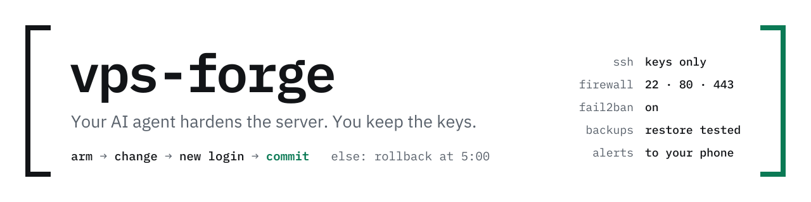
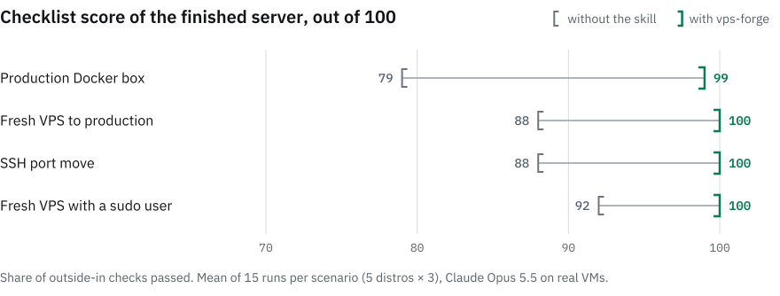
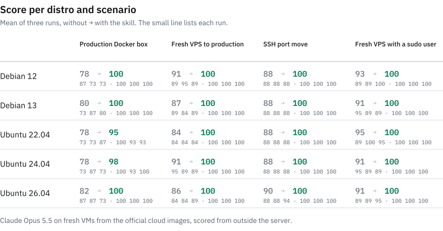
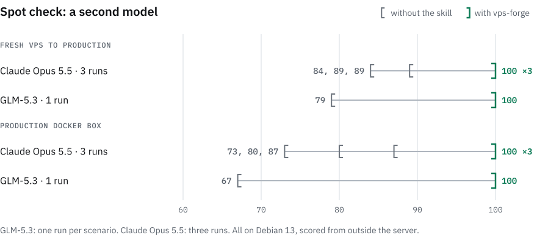

<p align="center"><sub><a href="README.md">English</a> · <a href="README.zh-CN.md">简体中文</a> · <a href="README.ja.md">日本語</a> · <b>Русский</b></sub></p>

<!-- translation of README.md, source sha256: cd214fcd1c0e -->

<p align="center"><sub>Это перевод английского README. Если версии расходятся, верна английская. Нашли ошибку в переводе? Откройте <a href="https://github.com/mountain-beaver/vps-forge/issues">issue</a>.</sub></p>

<p align="center">
  <picture>
    <source media="(prefers-color-scheme: dark)" srcset="docs/assets/banner-dark.svg">
    
  </picture>
</p>

<p align="center">
  <b>Попросите ИИ-агента настроить сервер — и получите такой, которому можно доверить продакшен.</b><br>
  Открытый <a href="https://agentskills.io">Agent Skill</a> для настройки, усиления защиты и аудита VPS на Debian и Ubuntu.<br>
  Работает с Claude Code, Codex, Cursor, GitHub Copilot, Gemini CLI, OpenCode и другими агентами, которые умеют загружать навыки.
</p>

<p align="center">
  <a href="https://github.com/mountain-beaver/vps-forge/releases/latest"></a>
  <a href="https://github.com/mountain-beaver/vps-forge/actions/workflows/ci.yml"></a>
  <a href="LICENSE"></a>
  <a href="https://agentskills.io"></a>
  
</p>

<p align="center">
  <a href="#быстрый-старт">Быстрый старт</a> ·
  <a href="#что-вы-говорите-и-что-получаете">Примеры</a> ·
  <a href="#у-каждого-рискованного-изменения-есть-автоматический-откат">Откат через 5 минут</a> ·
  <a href="#бенчмарк">Бенчмарк</a> ·
  <a href="#частые-вопросы">Частые вопросы</a>
</p>

Вы арендовали VPS, и агент уже умеет зайти на него по SSH и запустить ваше приложение. Обычно он пропускает то, что всплывает позже: криптографию SSH, которая не проходит сканер, файрвол, который так и не включили, fail2ban, который никого не банит, и тишину, когда кто-то входит на сервер. Или слишком усердно проверяет собственный вход, и ваш IP попадает в бан.

vps-forge учит агента делать всю работу целиком, в правильном порядке и со страховкой под каждым рискованным шагом. В итоге сервер защищён, у него есть бэкапы, мониторинг и документация, а любое изменение SSH, файрвола, sudo или PAM откатывается само, если вы больше не можете войти.

<p align="center">
  <picture>
    <source media="(prefers-color-scheme: dark)" srcset="docs/bench/chart-hero-dark.svg">
    
  </picture>
</p>

<p align="center"><sub>120 прогонов Claude Opus 5.5 на настоящих ВМ; оценку снаружи сервера ставил судья, которого написал тот же автор, что и навык. Около 70% разницы дают три проверки, совпадающие с настройками навыка по умолчанию. <a href="#бенчмарк">Как измеряли и чего этот замер не показывает</a>.</sub></p>

## Как это выглядит

<p align="center">
  <picture>
    <source media="(prefers-color-scheme: dark)" srcset="docs/assets/replay-dark.svg">
    
  </picture>
</p>

## Быстрый старт

**1. Установите навык** для своего агента. Для большинства агентов хватит одной команды:

```bash
npx skills add mountain-beaver/vps-forge -g
```

Установщик спросит, для каких агентов ставить навык. С `-g` навык ставится для вашего пользователя, и агент найдёт его в любой папке; без этого флага навык попадёт только в текущий проект. Команда взята из открытого установщика [`skills`](https://github.com/vercel-labs/skills) и требует Node.js 22.20 или новее. Нет Node? Используйте GitHub CLI или zip-архив, о них ниже. Чтобы проверить установку, спросите агента «какие у тебя есть навыки?» и найдите в ответе `vps-forge`. Потом, пока агент работает, следите за одним признаком: перед каждым изменением SSH или файрвола он запускает `vps-forge-deadman arm`. Если он меняет что-то из этого, не взведя таймер, остановите его: навык не загружен ([частые вопросы](#частые-вопросы)).

**2. Расскажите агенту о сервере.** Особые слова не нужны:

> У меня новый VPS на 203.0.113.10, захожу под root. Сделай из него нормальный продакшен-сервер для моего Docker-приложения на app.example.com, с бэкапами и оповещениями на телефон.

Агент подхватит навык, задаст до четырёх коротких вопросов, покажет план и пройдёт его этап за этапом. Он входит с вашим SSH-ключом и своего не получает, создаёт администратора, у которого есть только этот ключ, и отключает вход под root лишь после того, как заработал новый вход.

> [!IMPORTANT]
> **Прежде чем запускать агента на важном сервере,** сделайте снапшот у провайдера и найдите его веб-консоль (VNC или serial). Перед первым рискованным шагом агент убедится, что вы знаете, где эта консоль. Если изменение отрежет SSH, [dead-man switch](#у-каждого-рискованного-изменения-есть-автоматический-откат) («выключатель мертвеца») откатит его по таймеру (по умолчанию через 5 минут, для длинных изменений через 10), а на всё остальное есть консоль. Первый раз? Попробуйте на сервере, который не жалко.

<details>
<summary><b>Claude Code</b>: установка в виде плагина</summary>

```bash
claude plugin marketplace add mountain-beaver/vps-forge
claude plugin install vps-forge@vps-forge
```

Внутри сессии то же самое делает `/plugin marketplace add mountain-beaver/vps-forge`, после чего навык выбирается в `/plugin`. Чтобы потом обновить его, выполните `claude plugin update vps-forge@vps-forge`.
</details>

<details>
<summary><b>Codex, Cursor, GitHub Copilot, Gemini CLI, Antigravity, OpenCode, Windsurf, Cline, Amp, Roo</b>: по одному агенту</summary>

Передайте установщику имя агента и `-g`, если нужна установка для всего пользователя:

```bash
npx skills add mountain-beaver/vps-forge -g -a codex
```

| Агент | Значение `-a` |
|---|---|
| Codex | `codex` |
| Cursor | `cursor` |
| GitHub Copilot | `github-copilot` |
| Gemini CLI | `gemini-cli` |
| Antigravity | `antigravity` |
| OpenCode | `opencode` |
| Windsurf | `windsurf` |
| Cline | `cline` |
| Amp | `amp` |
| Roo Code | `roo` |

Полный список примерно из 80 агентов — в [таблице агентов](https://github.com/vercel-labs/skills/blob/main/docs/agents.md) установщика.
</details>

<details>
<summary><b>GitHub CLI</b>: <code>gh skill install</code></summary>

```bash
gh skill install mountain-beaver/vps-forge vps-forge --agent cursor --scope user
```

`--agent` принимает имена вроде `claude-code`, `codex`, `cursor`, `github-copilot`, `gemini-cli` и `opencode`; полный список выводит `gh skill install --help`. Закрепить конкретный релиз можно флагом `--pin v1.0.0`.
</details>

<details>
<summary><b>Claude.ai и Claude Desktop</b>: загрузка zip-архива</summary>

Скачайте `vps-forge-skill.zip` из [последнего релиза](https://github.com/mountain-beaver/vps-forge/releases/latest) и загрузите его в Settings → Capabilities → Skills → «Upload skill». Должно быть включено выполнение кода.

Чат-приложение не может зайти на сервер по SSH, поэтому там навык работает в **режиме скриптов**. Сначала он даёт аудит только для чтения: вы запускаете его и вставляете вывод обратно в чат. Потом — по одному короткому скрипту на этап. Перед каждым изменением SSH или файрвола скрипт останавливается и просит войти из второго терминала; если вход не удался, сервер сам отменит шаг. Всё запускаете вы, поэтому агент знает только то, что вы ему вставили, а для внешней проверки нужен терминал на Mac, Linux или в WSL.
</details>

<details>
<summary><b>Любой другой агент</b>: скопируйте папку</summary>

```bash
git clone https://github.com/mountain-beaver/vps-forge
mkdir -p ~/.agents/skills && cp -r vps-forge/skills/vps-forge ~/.agents/skills/   # или папка навыков вашего агента
```

Если агент вообще не поддерживает навыки, попросите его прочитать `skills/vps-forge/SKILL.md` и действовать по нему. Навык — это обычный Markdown и bash.
</details>

## Что вы говорите и что получаете

| Вы говорите | Агент делает |
|---|---|
| «Разверни моё Docker-приложение на этом новом VPS, с HTTPS». | Администратор с вашим ключом, root и пароли отключены, в файрволе только 22/80/443, Caddy с TLS, проверенные бэкапы, оповещения. |
| «Проверь мой сервер. Ничего не меняй». | Отчёт по аудиту без единого изменения, с находками по степени серьёзности, и план. |
| «Перенеси SSH на 2222 и поставь fail2ban. Больше ничего». | Ровно это, без риска потерять доступ, и одна строка с предложением сделать остальное. |
| «Присылай оповещения мне на телефон». | Оповещения через ntfy, Telegram или вебхук: о входах, сбоях, заполненных дисках и бэкапах. |
| «SSH только через Tailscale». | Публичный SSH закрывается только после того, как заработал вход через VPN. |
| «Мой сервер взломали?» | Проверка на компрометацию. Если найдутся признаки взлома, агент остановится и поможет пересобрать сервер. |
| «Подготовь этот VPS под Coolify». | То же усиление защиты, но root сохраняет вход по ключу для панели, порты 80/443 отданы её прокси, а порт её дашборда закрывается, как только заработает ваш домен. Подходит и для Dokploy, CapRover, Kamal и Dokku. |

## Что вы получите в итоге

| Область | На готовом сервере |
|---|---|
| **Доступ** | Администратор, у которого есть только ваш ключ. Вход под root и по паролю отключён, задан `AllowGroups`, а криптография SSH современная и подобрана под версию, поэтому сервер проходит `ssh-audit`. |
| **Файрвол** | ufw или nftables, всё запрещено по умолчанию, правила для IPv4 и IPv6 совпадают. Порты, которые публикует Docker, тоже под контролем, а ваш собственный IP всегда пропускается первым. |
| **Защита от вторжений** | fail2ban с бэкендом systemd и jail recidive; ваш IP попадает в список исключений ещё до первого запуска. CrowdSec на уровне paranoid. |
| **Обновления** | Автоматические обновления безопасности, в том числе для сторонних репозиториев, которые подключает навык (Caddy, Tailscale, CrowdSec и Docker, если вы согласитесь), needrestart и, по желанию, окно для перезагрузок. |
| **Веб и приложения** | Docker, привязанный к localhost, Caddy или nginx с TLS и заголовками безопасности, профили для баз данных и воркеров. |
| **Бэкапы** | restic на второй том или в объектное хранилище, по таймеру, с тестом восстановления, который обязан пройти. Postgres, MySQL и SQLite сначала выгружаются в дамп, а не копируются на ходу. |
| **Оповещения** | Оповещения на телефон о входах по SSH и проблемах со здоровьем сервера, с дедупликацией и heartbeat-сигналом. |
| **Повседневная работа** | motd со статусом, `/etc` под git через etckeeper и `SERVER.md`, где объяснён каждый открытый порт. Экспорт в cloud-init позволяет поднять следующий сервер точно таким же. |

<details>
<summary>Уровни и профили</summary>

| | **baseline** | **hardened** (по умолчанию) | **paranoid** |
|---|---|---|---|
| SSH | только ключи, без root, `AllowGroups` | + современные KEX и шифры (постквантовые, где доступны), host key ed25519, чистый `ssh-audit` | + FIDO2 или TOTP, SSH только через VPN |
| Файрвол | запрет по умолчанию | + паритет IPv6, правила для Docker, файрвол провайдера | + веб только через Cloudflare, ревизия исходящего трафика |
| Вторжения | fail2ban | + recidive | CrowdSec |
| Обновления | автоматические обновления безопасности | + needrestart, Livepatch | + окно перезагрузок |
| Бэкапы | restic и проверенное восстановление | + репозиторий, защищённый от удаления, еженедельная проверка | + второй удалённый репозиторий |
| Оповещения | проверка доступности | + оповещения на телефон, heartbeat | + дайджесты |

Профили сочетаются с любым уровнем: `web`, `docker`, `vpn`, `db`, `worker`, `game`.
</details>

## У каждого рискованного изменения есть автоматический откат

Одна ошибка в настройках `sshd` или файрвола — и сервер недоступен. Поэтому каждое изменение SSH, файрвола, sudo или PAM выполняется внутри **dead-man switch**:

<p align="center">
  <picture>
    <source media="(prefers-color-scheme: dark)" srcset="docs/assets/deadman-diagram-dark.svg">
    
  </picture>
</p>

1. `deadman.sh arm` делает снапшот конфигурации и запускает 5-минутный таймер systemd.
2. Агент вносит изменение и проверяет его (`sshd -t`, `visudo -c`, `nft -c`).
3. Он заново входит по **новому** подключению, которое не может переиспользовать старое.
4. Таймер снимается, только если этот вход удался.

Если новый вход не удался, от вас ничего не требуется: таймер восстановит снапшот, разбанит вас в fail2ban и вернёт службы в прежнее состояние. То же самое произойдёт при загрузке, если сервер перезапустится, пока dead-man switch взведён.

Откатить то, что находится вне сервера, он не может: файрвол в панели провайдера (Hetzner, DigitalOcean, security groups в AWS) или сетевые изменения на стороне провайдера. Поэтому там агент сначала добавляет новое правило, убеждается, что новый вход работает, и только потом удаляет старое. Если он ошибётся, останется лишнее открытое правило, а не закрытый для вас сервер. Каждый откат пишется в журнал с меткой `vps-forge-deadman`, а если оповещения на телефон уже настроены, приходит ещё и пуш с высоким приоритетом «Deadman fired».

<p align="center">
  <picture>
    <source media="(prefers-color-scheme: dark)" srcset="docs/assets/deadman-dark.svg">
    
  </picture>
</p>

**Не доверяете? Попробуйте сломать.** Dead-man switch — обычный bash-скрипт, и его можно проверить без всякого агента. На сервере, который не жалко, войдите пользователем с sudo, оставьте эту сессию открытой и выполните:

```bash
curl -fsSLO https://raw.githubusercontent.com/mountain-beaver/vps-forge/v1.1.1/skills/vps-forge/scripts/deadman.sh
less deadman.sh                                                       # прочитайте, прежде чем запускать от root
sudo install -m 755 deadman.sh /usr/local/sbin/vps-forge-deadman
sudo vps-forge-deadman arm 1                                          # откат через минуту
echo 'AllowUsers deploy' | sudo tee /etc/ssh/sshd_config.d/50-users.conf   # вы ведь не deploy
sudo sshd -t && sudo systemctl reload ssh                             # конфиг валиден, поэтому применяется
```

Теперь новый вход с вашей машины (`ssh -o ControlPath=none you@server`) отклоняется, и снять таймер некому. Подождите минуту: `sudo vps-forge-deadman status` в открытой сессии покажет `ROLLED BACK`, файла `50-users.conf` больше нет, и новый вход снова работает. В реальной работе вы запускаете `arm` перед рискованным изменением и `disarm`, когда новый вход заработал. Нет лишнего сервера? `make deadman-systemd` прогонит в контейнере podman этот сценарий и не только: сломанный файрвол, перезагрузку во взведённом состоянии, ufw и fail2ban.

Это гарантия, заложенная в устройство навыка, и бенчмарк её доказать не может: ни в одной из двух групп никто не потерял доступ, потому что Opus и сам по себе осторожен. Зато бенчмарк измерил случаи, когда до беды было недалеко. Без навыка агент в 7 прогонах из 60 по ходу работы отправил в бан fail2ban собственный IP администратора. С навыком — ни в одном из 60.

Другие правила, которым следует навык:
- **Сначала чтение, потом запись.** На работающем сервере агент сначала проводит аудит и ничего не меняет, пока вы не одобрите.
- **Секреты никогда не проходят через чат.** Пароли и токены генерируются на сервере, хранятся с правами 600 и передаются программам через stdin, а не аргументами.
- **Версии проверяются, а не угадываются.** Алгоритмы OpenSSH, SSH с активацией через сокет в Ubuntu 24.04 и бэкенды fail2ban отличаются от релиза к релизу.
- **Известные ловушки учтены**, в том числе:
  - `50-cloud-init.conf` от cloud-init молча включает пароли обратно поверх drop-in-файла `99-`, потому что sshd берёт первое прочитанное значение;
  - fail2ban не находит логи в Debian 12+, где нет `auth.log`;
  - Docker публикует порты в обход ufw.

## Бенчмарк

Суть теста: Claude Opus 5.5 дважды получает одну и ту же задачу на одном и том же сервере — один раз работает сам, другой раз с vps-forge.
- **Серверы:** настоящие ВМ QEMU из официальных облачных образов Debian 12/13 и Ubuntu 22.04/24.04/26.04.
- **Повторы:** каждая ячейка прогоняется трижды.
- **Пользователь недоступен:** в промпте сказано, что пользователь офлайн и не может отвечать на вопросы.

Затем отдельный судья проверяет каждый сервер снаружи, до и после перезагрузки. Скрипты самого навыка судья не использует. Он проверяет:
- пускает ли пользователя его ключ;
- какие методы аутентификации предлагает sshd, может ли войти root и что показывает `ssh-audit`;
- какие порты отвечают;
- действительно ли источник перебора паролей попадает в бан;
- восстанавливает ли бэкап данные приложения;
- доходят ли оповещения.

Потеря доступа — это 0 баллов.

<picture>
  <source media="(prefers-color-scheme: dark)" srcset="docs/bench/chart-checks-dark.svg">
  
</picture>

| | Без навыка | С vps-forge |
|---|---:|---:|
| `ssh-audit` без провалов | 4 / 60 | **60 / 60** |
| Оповещение о новом входе по SSH | 16 / 30 | **30 / 30** |
| Файрвол на хосте активен | 46 / 60 | **60 / 60** |
| Источник перебора паролей действительно попадает в бан | 50 / 60 | **60 / 60** |
| Root не может войти по SSH | 30 / 60 | **57 / 60** |
| Бэкап, из которого восстанавливаются данные приложения | 30 / 30 | 30 / 30 |
| IP администратора забанен, пока работал агент | 7 / 60 | **0 / 60** |
| Администратор потерял доступ | 0 / 60 | 0 / 60 |

<picture>
  <source media="(prefers-color-scheme: dark)" srcset="docs/bench/chart-grid-dark.svg">
  
</picture>

**Где навык не помогает и что нужно учитывать**
- **Opus и сам по себе хорош.** Без навыка он набирает 79–92 балла, а нетронутые серверы получают 25–42. Навык закрывает последние 8–20 баллов, и именно они потом дают о себе знать: криптография SSH, которая проходит `ssh-audit`, оповещение о входе, файрвол, который действительно включён, и fail2ban, который действительно банит.
- **Общий аудит почти не меняется.** Оценки Lynis почти одинаковы с навыком и без него: 69 против 71, 72 против 72, 64 против 72 и 73 против 72. Разница — в проверках выше, а не в обобщённом индексе защищённости.
- **Бэкапы.** Opus и без навыка пишет рабочий бэкап, если его попросить: в обеих группах каждый прогон восстановил данные приложения.
- **Большая часть разницы — это настройки самого навыка по умолчанию.** Три проверки отражают решения, которые навык принимает в любом случае: чистый `ssh-audit`, запрет входа под root и оповещение о каждом входе по SSH. Если их убрать, сценарии с новым VPS дают 100 против 100 и 100 против 100, продакшен-сервер — 91 против 100, а перенос порта SSH — 93 против 100. Это около 70% разницы.
- **Что остаётся сверх этих настроек:** fail2ban, который действительно банит атакующего на уже работающем продакшен-сервере (6 из 15 прогонов без навыка, 15 из 15 с ним), файрвол на хосте, о котором пользователь не просил, и то, что агент не банит сам себя (без навыка это случилось в 7 прогонах из 60, с ним — в 0 из 60).
- **Вход под root — спорный вопрос.** Судья ставит незачёт серверу, на который root ещё может войти по ключу. В двух сценариях, где прогоны без навыка провалили эту проверку, в промпте сказано, что пользователь сейчас входит под root, так что оставить root вход только по ключу — решение, которое можно обосновать. Без этой проверки оценки составляют 85–93 без навыка и 100 с ним.
- **Вопросы и подтверждения не тестировались.** В каждом промпте сказано, что пользователь офлайн и агент должен решать сам, поэтому вводные вопросы навыка и шаги подтверждения ни разу не запускались. А именно в этом режиме навык обычно и работает с реальным пользователем.
- **Это дольше и дороже.** Медианный прогон занял 5–8 минут вместо 3–6, потому что навык делает снапшоты, взводит dead-man switch и проверяет каждое изменение из нового подключения. По прейскурантным ценам API медианная стоимость прогона составила $1.87 с навыком и $0.62 без него, то есть примерно 3×, а инструкции навыка ещё и занимают место в контексте агента.
- **Версия навыка из бенчмарка делала больше, чем просил чек-лист.** Один сценарий просит только перенести SSH на 2222, добавить sudo-пользователя, отключить вход по паролю и под root, поставить fail2ban и включить автообновления. Без навыка он получает 88: Opus выполняет все пять пунктов, но сервер не проходит `ssh-audit` и остаётся без файрвола на хосте, о котором в промпте не было ни слова. Версия навыка из бенчмарка всё равно применила свой базовый набор уровня hardened и получила 100. С 1.1.0 навык так больше не делает: на узкий запрос он выполняет то, что просили, и предлагает остальное. Поэтому эти 100 баллов описывают старое поведение, а новое в бенчмарке не проверялось.
- **Сценарии не новы для навыка.** Ранняя версия навыка набрала 92, 100 и 89 в первых трёх сценариях. В 12 из этих 45 прогонов тестовые входы самого агента вызывали срабатывание fail2ban, который он только что настроил. Навык доработали именно под эти сбои, поэтому эти три сценария больше не проверяют его вслепую. Четвёртый, новый VPS только с sudo-пользователем, добавили после доработки, и в нём тоже 100.
- **Навык нацелен на то, что проверяет судья.** Он добивается чистого `ssh-audit`, а судья запускает `ssh-audit`. Поэтому рядом показан общий индекс Lynis, о котором сказано выше.
- **Малые выборки, один судья.** Каждый дистрибутив и сценарий прогонялся трижды в каждой группе, а судью написал тот же автор, что и навык. Стенд опубликован, проверить его может любой.
- **В бенчмарке одна модель, ещё одна — в выборочной проверке.** Полный бенчмарк проводился только на Claude Opus 5.5. GLM-5.3 прошла выборочную проверку: вручную в десктопном приложении ZCode, по одному прогону на группу на Debian 13, в двух сценариях. Она набрала 79 → 100 на новом VPS и 67 → 100 на продакшен-сервере, без потери доступа и без самобанов. Без навыка она пропустила те же настройки по умолчанию, что и Opus, а на продакшен-сервере не настроила ни fail2ban, ни автоматические обновления. Если убрать три проверки, совпадающие с настройками навыка, остаётся 94 против 100 и 77 против 100. Четыре прогона — это единичные наблюдения, а не бенчмарк: [результаты по проверкам](docs/bench/glm-5.3.md). Другие агенты и модели не тестировались.

<picture>
  <source media="(prefers-color-scheme: dark)" srcset="docs/bench/chart-spot-dark.svg">
  
</picture>

Бенчмарк проводился на предрелизной версии навыка. Версия 1.0.1 изменила только текст. Версия 1.1.0 изменила поведение там, где бенчмарк почти ничего не говорит или молчит совсем: узкие запросы, срок действия временного права на sudo, учения по восстановлению с проверкой данных приложения и остановка на узлах Kubernetes и хостах гипервизоров. Версия 1.1.1 изменила только README, его изображения и упаковку. Изменения после неё, перечисленные в разделе Unreleased в CHANGELOG (панели деплоя, режим скриптов, более тихие оповещения о входе, `extend`), в бенчмарке тоже не проверялись. Все изменения перечислены в [CHANGELOG.md](CHANGELOG.md). Сценарии, стенд и всё, что нужно для воспроизведения прогонов, лежат в [`bench/`](bench/README.md). Результаты по каждому прогону — в [`docs/bench/results.md`](docs/bench/results.md) и [`results.json`](docs/bench/results.json).

## Частые вопросы

<details>
<summary><b>Безопасно ли разрешать ИИ-агенту выполнять команды от root на моём сервере?</b></summary>

С навыком это безопаснее, чем без него, — ради этого он и создан. Изменения, способные отрезать доступ, выполняются внутри описанного выше dead-man switch. Изменения конфигов коммитятся в git в `/etc` через etckeeper, так что их можно откатить. На сервере, который уже в продакшене, агент сначала проводит аудит и ничего не меняет без вашего одобрения. И всё же держите под рукой снапшоты и веб-консоль провайдера.
</details>

<details>
<summary><b>С каким ключом входит агент? Оставляет ли он себе root?</b></summary>

С вашим. Обычно агент работает на вашей машине и подключается так же, как вы, поэтому собственного ключа не получает. Если сейчас вы входите под root, он начинает оттуда: создаёт администратора, у которого есть только тот ключ, с которым вы подключаетесь, проверяет этот вход из нового подключения и затем отключает вход под root и по паролю. Вход под root он оставляет, только если вы скажете, что он нужен инструменту деплоя.

Спрашивает ли `sudo` пароль — решать вам. Вариант без пароля проще, но тогда один украденный ключ сразу даёт root. Если sudo с паролем, агент работает с временным правом на sudo без пароля, которое истекает по таймеру через четыре часа, даже если сервер перезагружался, а последним шагом агент удаляет это право сам. Если агент работал не с вашей машины, а из облачной песочницы, в конце он также удаляет свой IP из списков разрешённых в файрволе, fail2ban и sshd. Всё, что осталось, `audit.sh` пометит.
</details>

<details>
<summary><b>Не закрутит ли он гайки так, что сервером станет неудобно пользоваться?</b></summary>

Насколько далеко заходить, решаете вы. `baseline` — это только ключи, root отключён, файрвол с запретом по умолчанию и fail2ban; `hardened`, уровень по умолчанию, добавляет современную криптографию SSH, правила файрвола с учётом Docker и оповещения; и только `paranoid` прячет SSH за VPN или добавляет FIDO2. Узкий запрос вроде «перенеси SSH и поставь fail2ban» получает ровно это и одну строку с предложением сделать остальное. Прежде чем сменить порт SSH, отключить вход по паролю или включить автоматические перезагрузки, агент спросит вас, если только вы не велели ему решать самому. В `SERVER.md` перечислен каждый открытый порт и то, зачем он открыт.
</details>

<details>
<summary><b>Я не системный администратор. Мне это подойдёт?</b></summary>

Да, навык сделан именно для вас. Перед каждым изменением агент одной строкой говорит, что делает и зачем, и толком отвечает, если вы спросите. В конце на сервере появляется `SERVER.md`: что там работает, какие порты открыты и почему, куда уходят бэкапы и как из них восстановиться.
</details>

<details>
<summary><b>С какими агентами и моделями он работает?</b></summary>

С любым агентом, который загружает [Agent Skills](https://agentskills.io) и умеет выполнять команды в оболочке: Claude Code, Codex, Cursor, GitHub Copilot, Gemini CLI, Antigravity, OpenCode, Windsurf, Cline, Amp, Roo Code и другими. Для чат-приложений без оболочки есть режим скриптов. Для Claude Opus 5.5 есть полный бенчмарк, для GLM-5.3 в ZCode — выборочная проверка из четырёх прогонов. Результаты с другими агентами присылайте в issue.
</details>

<details>
<summary><b>Похоже, агент не использует навык. Что делать?</b></summary>

Остановите его, пока он не изменил SSH или файрвол: без навыка нет и dead-man switch. Понять это можно по самой работе. С загруженным навыком агент задаёт несколько коротких вопросов, показывает план, убеждается, что вы знаете, где веб-консоль провайдера, и запускает `vps-forge-deadman arm` перед каждым изменением SSH или файрвола. Изменение SSH или файрвола без `arm` — верный признак того, что навык не загружен. Обычные причины:
- **Навык установлен в другой проект.** Без `-g` команда `npx skills add` ставит его только в текущую папку. Переустановите с `-g` или запускайте агента в той папке.
- **Сессия началась до установки.** Агенты читают список навыков при старте сессии, так что откройте новую.
- **Плагин Claude Code:** проверьте в `/plugin`, что `vps-forge` установлен и включён.
- **Claude.ai и Claude Desktop:** навык должен быть включён в Settings → Capabilities → Skills, и должно быть включено выполнение кода.
- **Запрос не был похож на работу с сервером.** Скажите прямо: «используй навык vps-forge, чтобы защитить сервер 203.0.113.10».
</details>

<details>
<summary><b>Какие серверы поддерживаются?</b></summary>

Debian 12 и 13, Ubuntu 22.04, 24.04 и 26.04, у любого провайдера: Hetzner, DigitalOcean, Vultr, Linode, OVH, AWS (EC2 и Lightsail), Oracle Cloud или машина у вас под столом, на x86 или ARM. Навык знает ловушки каждого из них, например встроенное правило reject в `iptables` у Oracle Cloud. Агент работает с вашей машины по SSH. Поддержка семейства RHEL в планах.
</details>

<details>
<summary><b>Это платно?</b></summary>

Навык бесплатный: лицензия MIT, без аккаунта и без платных тарифов. Но расход у агента вырастет. В бенчмарке медианная стоимость прогона с навыком по прейскурантным ценам API составила $1.87 против $0.62 без него, потому что агент делает больше и проверяет каждый шаг. На подписке это выразится в большем расходе лимита.
</details>

<details>
<summary><b>Что, если я всё-таки потеряю доступ?</b></summary>

Дождитесь таймера: взведённый dead-man switch откатит изменение сам — по умолчанию через 5 минут, для длинных изменений через 10. Из консоли провайдера `vps-forge-deadman status` покажет, когда именно. Если сервер за это время перезагрузили, откат выполнится при загрузке. Если войти всё равно не получается, проверьте файрвол провайдера в его веб-панели: его dead-man switch откатить не может. Затем откройте веб-консоль провайдера (VNC или serial) и выполните `vps-forge-deadman restore` или откатите последний коммит etckeeper в `/etc`.
</details>

<details>
<summary><b>Как обновить или удалить навык?</b></summary>

**Обновить навык:** `npx skills update -g vps-forge` (без `-g` для установки в проект), `claude plugin update vps-forge@vps-forge` для плагина Claude Code, `gh skill update vps-forge` или загрузите новый zip.

**Удалить навык:** `npx skills remove -g vps-forge`, `claude plugin uninstall vps-forge@vps-forge` или удалите папку. На серверах при этом ничего не меняется: защита остаётся, в этом и смысл.

**Откатить изменения на сервере:** каждое изменение — это коммит в `/etc` (`sudo git -C /etc log`), поэтому любое из них можно посмотреть и откатить. В именах добавленных файлов есть `vps-forge`; их список выводит `sudo find /etc /usr/local /var/lib -name '*vps-forge*'`. Исключения — `/usr/local/bin/vps-notify`, `/etc/restic/` и одна строка `pam_exec` в `/etc/pam.d/sshd`. `install-alerts.sh --uninstall` аккуратно удаляет оповещения. Установленные пакеты, например fail2ban, restic или Caddy, удаляются через `apt purge`. Файлы SSH и файрвола удаляйте внутри dead-man switch, как и любое другое рискованное изменение.
</details>

<details>
<summary><b>Отправляет ли он куда-нибудь данные?</b></summary>

Нет. В навыке и его скриптах нет телеметрии. Оповещения уходят только в тот топик ntfy, чат Telegram или вебхук, который вы настроили. Внешнее сканирование запускается с вашей собственной машины, а `ssh-audit` включается только по желанию.
</details>

<details>
<summary><b>Можно ли пользоваться скриптами без ИИ-агента?</b></summary>

Да. `audit.sh` — самостоятельный аудит только для чтения:

```bash
curl -fsSLO https://raw.githubusercontent.com/mountain-beaver/vps-forge/v1.1.1/skills/vps-forge/scripts/audit.sh
less audit.sh          # прочитайте, прежде чем запускать что-либо от root
sudo bash audit.sh     # только чтение; --json для машинного вывода
```

`deadman.sh`, `external-check.sh` и `install-alerts.sh` тоже работают сами по себе. У каждого есть `--help`.
</details>

## Что внутри

```
skills/vps-forge/
├── SKILL.md              порядок работы, правила безопасности, уровни, критерии готовности
├── references/           по файлу на этап, загружаются только при необходимости
├── scripts/
│   ├── audit.sh          аудит только для чтения: 70+ проверок, оценка, JSON
│   ├── deadman.sh        снапшот и автоматический откат для SSH, файрвола, sudo и PAM
│   ├── external-check.sh внешняя проверка с вашей машины: порты, аутентификация SSH, TLS, ssh-audit
│   └── install-alerts.sh vps-notify: оповещения через ntfy, Telegram или вебхук
├── assets/               проверенные шаблоны: sshd, sysctl, fail2ban, apt, Docker, Caddy,
│                         restic, синхронизация с Cloudflare, motd, SERVER.md, cloud-init
└── evals/                тест-кейсы поведения
```

Каждый шаблон проверяется в CI тем инструментом, который его читает (`sshd -t`, `fail2ban-client -t`, `caddy validate`, `cloud-init schema`, `systemd-analyze verify`, `dockerd --validate`), на Debian 12/13 и Ubuntu 22.04/24.04/26.04. `audit.sh` тестируется на заведомо исправных и проблемных серверах, а контрольная сумма доказывает, что он ничего не меняет. Откат dead-man switch тестируется в CI на настоящем systemd: взвести, сломать SSH или файрвол, подождать и убедиться, что всё вернулось, в том числе после перезагрузки.

## Как помочь проекту

Issues и pull requests приветствуются, особенно про пограничные случаи дистрибутивов, особенности провайдеров и прогоны бенчмарка с другими агентами. В [CONTRIBUTING.md](CONTRIBUTING.md) описано, как всё настроить: `make test` выполняется за секунды без root, а `make ci` запускает все наборы тестов в контейнерах. Нашли способ, которым навык может закрыть кому-то доступ или оставить сервер менее защищённым? Пожалуйста, сообщите об этом приватно, как описано в [SECURITY.md](SECURITY.md).

Если vps-forge сэкономил вам вечер или спас сервер, поставьте звезду — так его проще найти другим.

## Лицензия

[MIT](LICENSE). Навык вносит изменения на серверах от root. Он сделан так, чтобы действовать осторожно, но за свои системы отвечаете вы: держите снапшоты и доступ к консоли и читайте, что он запускает.
