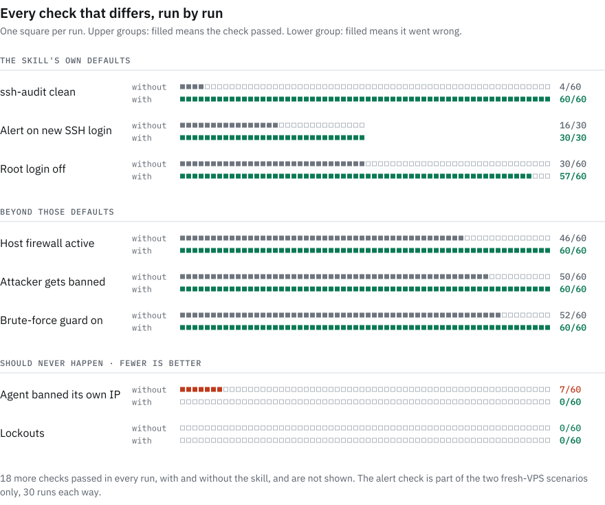

<p align="center"><sub><a href="README.md">English</a> · <b>简体中文</b> · <a href="README.ja.md">日本語</a> · <a href="README.ru.md">Русский</a></sub></p>

<!-- translation of README.md, source sha256: cd214fcd1c0e -->

<p align="center"><sub>本文是英文 README 的译文，两者如有出入，以英文版为准。翻译有误之处，欢迎提交 <a href="https://github.com/mountain-beaver/vps-forge/issues">issue</a> 指正。</sub></p>

<p align="center">
  <picture>
    <source media="(prefers-color-scheme: dark)" srcset="docs/assets/banner-dark.svg">
    
  </picture>
</p>

<p align="center">
  <b>让 AI 编程 Agent 帮你配置服务器，得到一台你敢放心投入生产的机器。</b><br>
  一个开放的 <a href="https://agentskills.io">Agent Skill</a>，用于 Debian 和 Ubuntu VPS 的初始配置、安全加固和审计。<br>
  适用于 Claude Code、Codex、Cursor、GitHub Copilot、Gemini CLI、OpenCode 以及其他能读取技能的 Agent。
</p>

<p align="center">
  <a href="https://github.com/mountain-beaver/vps-forge/releases/latest"></a>
  <a href="https://github.com/mountain-beaver/vps-forge/actions/workflows/ci.yml"></a>
  <a href="LICENSE"></a>
  <a href="https://agentskills.io"></a>
  
</p>

<p align="center">
  <a href="#快速开始">快速开始</a> ·
  <a href="#你说什么它做什么">示例</a> ·
  <a href="#每个高风险改动都能自动撤销">5 分钟自动撤销</a> ·
  <a href="#基准测试">基准测试</a> ·
  <a href="#常见问题">常见问题</a>
</p>

你租了一台 VPS，Agent 已经能 SSH 登录上去，把你的应用跑起来。它通常会漏掉的，是那些日后才会暴露的部分：SSH 加密配置过不了扫描，防火墙从来没启用，fail2ban 一个 IP 也没封，有人登录也没有任何告警。又或者它测试自己的登录时太心急，把你的 IP 给封了。

vps-forge 教 Agent 把整件事做完，按正确的顺序，并且在每个高风险步骤下面都铺好安全网。最终服务器会被锁紧，有备份、有监控、有文档；对 SSH、防火墙、sudo 或 PAM 的每次改动，除非确认你仍然能登录，否则都会自动回滚。

<p align="center">
  <picture>
    <source media="(prefers-color-scheme: dark)" srcset="docs/bench/chart-hero-dark.svg">
    
  </picture>
</p>

<p align="center"><sub>在真实虚拟机上运行 Claude Opus 5.5 共 120 次，由同一作者编写的评判程序从服务器外部打分。差距中约 70% 来自三项恰好与技能自身默认设置一致的检查。<a href="#基准测试">测量方法及其局限</a>。</sub></p>

## 实际效果

<p align="center">
  <picture>
    <source media="(prefers-color-scheme: dark)" srcset="docs/assets/replay-dark.svg">
    
  </picture>
</p>

## 快速开始

**1. 安装技能**，装到你使用的 Agent 上。一条命令就能覆盖大多数 Agent：

```bash
npx skills add mountain-beaver/vps-forge -g
```

它会询问要为哪些 Agent 安装。`-g` 表示为当前用户安装，这样 Agent 在任何目录下都能找到它；不加这个参数则只安装到当前项目。这条命令来自开源的 [`skills`](https://github.com/vercel-labs/skills) 安装器，需要 Node.js 22.20 或更高版本；没有 Node？可以用下面的 GitHub CLI 或 zip 包。想确认安装成功，可以问 Agent“你有哪些技能？”，看看列表里有没有 `vps-forge`。之后在它工作时留意一个信号：每次修改 SSH 或防火墙之前，Agent 都会先运行 `vps-forge-deadman arm`。如果它没有先布防就改动了其中任何一项，请立即叫停，因为技能没有被加载（见[常见问题](#常见问题)）。

**2. 和 Agent 聊聊你的服务器。** 不需要什么特殊措辞：

> 我刚买了一台 VPS，IP 是 203.0.113.10，用 root 登录。帮我把它配置成一台像样的生产服务器，用来跑 app.example.com 上的 Docker 应用，要有备份，告警发到我手机上。

Agent 会自动用上这个技能，最多问四个简短的问题，给出计划，然后分阶段执行。它用你自己的 SSH 密钥登录，自己不持有任何密钥；它会创建一个只持有这把密钥的管理员用户，并且只在新用户能正常登录之后才关闭 root 登录。

> [!IMPORTANT]
> **在把它用到你在意的服务器之前：** 先在服务商那里做一个快照，并找到服务商的网页控制台（VNC 或串口）。Agent 在执行第一个高风险步骤之前，会确认你知道控制台在哪里。如果某次改动切断了 SSH，[失效保护开关](#每个高风险改动都能自动撤销)（dead-man switch，俗称“死人开关”）会按计时器把它回滚（默认 5 分钟，耗时较长的改动为 10 分钟），其余情况则靠控制台兜底。第一次用？先找一台用完即弃的机器试试。

<details>
<summary><b>Claude Code</b>：以插件形式安装</summary>

```bash
claude plugin marketplace add mountain-beaver/vps-forge
claude plugin install vps-forge@vps-forge
```

在会话中也可以用 `/plugin marketplace add mountain-beaver/vps-forge` 完成同样的操作，然后在 `/plugin` 中选中它。以后要更新，运行 `claude plugin update vps-forge@vps-forge`。
</details>

<details>
<summary><b>Codex, Cursor, GitHub Copilot, Gemini CLI, Antigravity, OpenCode, Windsurf, Cline, Amp, Roo</b>：逐个 Agent 安装</summary>

把 Agent 名称传给安装器，加上 `-g` 则为当前用户全局安装：

```bash
npx skills add mountain-beaver/vps-forge -g -a codex
```

| Agent | `-a` 取值 |
|---|---|
| Codex | `codex` |
| Cursor | `cursor` |
| GitHub Copilot | `github-copilot` |
| Gemini CLI | `gemini-cli` |
| Antigravity | `antigravity` |
| OpenCode | `opencode` |
| Windsurf | `windsurf` |
| Cline | `cline` |
| Amp | `amp` |
| Roo Code | `roo` |

完整列表（约 80 个 Agent）见安装器的 [Agent 列表](https://github.com/vercel-labs/skills/blob/main/docs/agents.md)。
</details>

<details>
<summary><b>GitHub CLI</b>：<code>gh skill install</code></summary>

```bash
gh skill install mountain-beaver/vps-forge vps-forge --agent cursor --scope user
```

`--agent` 接受 `claude-code`、`codex`、`cursor`、`github-copilot`、`gemini-cli` 和 `opencode` 等名称；`gh skill install --help` 会列出全部可选值。用 `--pin v1.0.0` 可以固定到某个发布版本。
</details>

<details>
<summary><b>Claude.ai 和 Claude Desktop</b>：上传 zip 包</summary>

从[最新发布](https://github.com/mountain-beaver/vps-forge/releases/latest)下载 `vps-forge-skill.zip`，然后在 Settings → Capabilities → Skills → "Upload skill" 中上传。需要开启代码执行（Code execution）。

聊天应用无法 SSH 到你的服务器，所以在那里技能以**脚本模式**工作。它先给你一段只读的审计脚本，由你运行后把输出贴回来，然后每个阶段给你一段简短的脚本。每次修改 SSH 或防火墙之前，脚本都会停下来，请你从第二个终端登录；如果这次登录失败，服务器会自行撤销这一步。所有命令都由你自己运行，因此 Agent 只知道你贴回来的内容，而从外部进行的检查需要 Mac、Linux 或 WSL 终端。
</details>

<details>
<summary><b>其他任何 Agent</b>：复制文件夹</summary>

```bash
git clone https://github.com/mountain-beaver/vps-forge
mkdir -p ~/.agents/skills && cp -r vps-forge/skills/vps-forge ~/.agents/skills/   # 或者你的 Agent 使用的技能目录
```

如果你的 Agent 完全不支持技能，就让它读取 `skills/vps-forge/SKILL.md` 并照着执行。技能本身只是普通的 Markdown 和 bash。
</details>

## 你说什么，它做什么

| 你说 | Agent 做的事 |
|---|---|
| “把我的 Docker 应用部署到这台新 VPS 上，要有 HTTPS。” | 创建持有你密钥的管理员用户，关闭 root 和密码登录，防火墙只开放 22/80/443，配置带 TLS 的 Caddy，备份经过测试，配置告警。 |
| “审计我的服务器，什么都别改。” | 一份按严重程度排序的只读报告，外加一份计划。 |
| “把 SSH 改到 2222 端口，再加上 fail2ban，别的都不要动。” | 只做这两件事，安全地做完，并用一句话提议其余的加固。 |
| “把告警发到我手机上。” | 通过 ntfy、Telegram 或 webhook 推送告警，覆盖登录、故障、磁盘写满和备份。 |
| “SSH 只能通过 Tailscale 访问。” | 只有在通过 VPN 登录成功之后，才关闭公网 SSH。 |
| “我的服务器是不是被黑了？” | 做一次入侵排查。如果发现迹象，它会停下来，引导你重建服务器。 |
| “帮这台 VPS 做好部署 Coolify 的准备。” | 同样的加固，但 root 保留密钥登录供面板使用，80/443 交给面板自带的代理，域名生效后关闭面板的管理端口。Dokploy、CapRover、Kamal 和 Dokku 同样适用。 |

## 最终得到的服务器

| 方面 | 完成后的服务器上 |
|---|---|
| **访问** | 一个只持有你密钥的管理员用户。root 登录和密码登录均已关闭，设置了 `AllowGroups`，SSH 加密算法采用现代配置并会根据版本调整，因此能通过 `ssh-audit`。 |
| **防火墙** | ufw 或 nftables，默认拒绝，IPv4 与 IPv6 规则保持一致。Docker 发布的端口也在管控范围内，你自己的 IP 总是最先放行。 |
| **入侵防护** | fail2ban 使用 systemd 后端并启用 recidive jail，在它首次启动之前就已把你的 IP 加入忽略列表。paranoid 级别使用 CrowdSec。 |
| **更新** | 无人值守的安全更新，同样覆盖它添加的第三方软件源（Caddy、Tailscale、CrowdSec，以及经你同意后的 Docker），外加 needrestart 和可选的重启时间窗口。 |
| **Web 与应用** | Docker 只绑定 localhost，Caddy 或 nginx 配置 TLS 和安全响应头，并提供数据库和 worker 配置档。 |
| **备份** | restic 备份到第二块卷或对象存储，由定时器触发，并且必须通过恢复测试。Postgres、MySQL 和 SQLite 会先导出，绝不在运行中直接复制数据文件。 |
| **告警** | SSH 登录和健康问题会推送到手机，带去重和心跳。 |
| **日常运维** | 状态 motd，用 etckeeper 把 `/etc` 纳入 git 管理，以及一份解释每个开放端口的 `SERVER.md`。导出的 cloud-init 配置可以让你的下一台服务器与这台完全一致。 |

<details>
<summary>级别与配置档</summary>

| | **baseline** | **hardened**（默认） | **paranoid** |
|---|---|---|---|
| SSH | 仅限密钥，禁止 root，`AllowGroups` | + 现代 KEX 和加密算法（可用时启用后量子算法）、ed25519 主机密钥、`ssh-audit` 无问题 | + FIDO2 或 TOTP，SSH 只能经 VPN 访问 |
| 防火墙 | 默认拒绝 | + IPv6 规则一致、Docker 规则、服务商防火墙 | + Web 仅对 Cloudflare 开放、审查出站流量 |
| 入侵防护 | fail2ban | + recidive | CrowdSec |
| 更新 | 无人值守安全更新 | + needrestart、Livepatch | + 重启时间窗口 |
| 备份 | restic 及经过测试的恢复 | + 防删除的仓库、每周校验 | + 第二个异地仓库 |
| 告警 | 可用性检查 | + 手机告警、心跳 | + 定期摘要 |

配置档可与任意级别组合：`web`、`docker`、`vpn`、`db`、`worker`、`game`。
</details>

## 每个高风险改动都能自动撤销

一次错误的 `sshd` 或防火墙改动，就可能让服务器再也连不上。所以每次对 SSH、防火墙、sudo 或 PAM 的改动，都在**失效保护开关**的保护下进行：

<p align="center">
  <picture>
    <source media="(prefers-color-scheme: dark)" srcset="docs/assets/deadman-diagram-dark.svg">
    
  </picture>
</p>

1. `deadman.sh arm` 为配置做快照，并启动一个 5 分钟的 systemd 计时器。
2. Agent 进行改动并校验（`sshd -t`、`visudo -c`、`nft -c`）。
3. 它通过一个**新**连接重新登录，这个连接无法复用旧连接。
4. 只有这次登录成功，它才会撤防、关掉计时器。

如果新登录失败，你什么都不用做：计时器会恢复快照，在 fail2ban 中为你解封，并把各项服务恢复原状。如果开关处于布防状态时服务器重启了，它会在开机时做同样的事。

它无法撤销服务器之外的东西：服务商控制面板里的防火墙（Hetzner、DigitalOcean、AWS 安全组），或服务商一侧的网络变更。对于这些，Agent 会先添加新规则，证明新登录可用，然后才删除旧规则；这样即使出错，结果也只是多开了一条规则，而不是把你锁在门外。每次回滚都会以 `vps-forge-deadman` 的名义记入 journal；配置好手机告警后，还会发送一条高优先级的“Deadman fired”推送。

<p align="center">
  <picture>
    <source media="(prefers-color-scheme: dark)" srcset="docs/assets/deadman-dark.svg">
    
  </picture>
</p>

**不信？那就亲手弄坏它。** 这个开关只是一个普通的 bash 脚本，不需要任何 Agent 就能试。在一台用完即弃的服务器上，以有 sudo 权限的用户登录，保持当前会话不要断开，然后运行：

```bash
curl -fsSLO https://raw.githubusercontent.com/mountain-beaver/vps-forge/v1.1.1/skills/vps-forge/scripts/deadman.sh
less deadman.sh                                                       # 以 root 运行之前先通读一遍
sudo install -m 755 deadman.sh /usr/local/sbin/vps-forge-deadman
sudo vps-forge-deadman arm 1                                          # 一分钟后回滚
echo 'AllowUsers deploy' | sudo tee /etc/ssh/sshd_config.d/50-users.conf   # 你的用户名不是 "deploy"
sudo sshd -t && sudo systemctl reload ssh                             # 配置合法，所以会被应用
```

现在从你的机器发起新登录（`ssh -o ControlPath=none you@server`）会被拒绝，因此没人能撤防。等一分钟：在仍然打开的会话里，`sudo vps-forge-deadman status` 显示 `ROLLED BACK`，`50-users.conf` 已被删除，新登录又能成功了。实际使用时，你在高风险改动之前运行 `arm`，在新登录成功后运行 `disarm`。没有多余的服务器？`make deadman-systemd` 会在 podman 容器里运行这个测试以及更多场景：防火墙配置出错、布防期间重启、ufw 和 fail2ban。

这是设计层面的保证，基准测试证明不了它：两组测试中都没有人被锁在外面，因为 Opus 本身就很谨慎。基准测试真正测到的是“险些出事”的情况。不用技能时，60 次运行中有 7 次，Agent 在工作过程中让 fail2ban 封掉了自己的管理 IP。使用技能时，60 次中一次也没有发生。

技能遵循的其他规则：
- **先读后写。** 在已经运行中的服务器上，它会先做审计，在你批准之前不做任何改动。
- **机密信息绝不经过聊天。** 密码和令牌在服务器上生成，以 600 权限保存，通过 stdin 传给工具，绝不作为命令行参数。
- **版本靠检查，不靠假设。** OpenSSH 支持的算法、Ubuntu 24.04 上通过 socket 激活的 SSH、fail2ban 的后端，在不同发行版本之间都有差异。
- **已知的坑都已处理**，包括：
  - cloud-init 的 `50-cloud-init.conf` 会悄悄压过 `99-` 开头的 drop-in，重新启用密码登录，因为 sshd 采用它读到的第一个值；
  - fail2ban 在 Debian 12+ 上找不到日志，因为那里没有 `auth.log`；
  - Docker 发布的端口会直接绕过 ufw。

## 基准测试

测试方法：在同一台服务器上把同样的任务交给 Claude Opus 5.5 两次，一次让它独立完成，一次使用 vps-forge。
- **服务器：** 真实的 QEMU 虚拟机，基于 Debian 12/13 和 Ubuntu 22.04/24.04/26.04 的官方云镜像构建。
- **重复次数：** 每个单元格运行三次。
- **用户无法响应：** 提示词说明用户不在线，无法回答问题。

随后，由一个独立的评判程序在重启前后分别从外部检查每台服务器。评判程序从不使用技能自带的脚本。它检查：
- 用户的密钥能否登录；
- sshd 提供哪些认证方式、root 能否登录，以及 `ssh-audit` 的结果；
- 哪些端口有响应；
- 暴力破解的来源是否真的会被封禁；
- 备份能否恢复应用的数据；
- 告警是否送达。

一旦被锁在外面，得分记为 0。

<picture>
  <source media="(prefers-color-scheme: dark)" srcset="docs/bench/chart-checks-dark.svg">
  
</picture>

| | 不用技能 | 使用 vps-forge |
|---|---:|---:|
| `ssh-audit` 无失败项 | 4 / 60 | **60 / 60** |
| 新 SSH 登录时告警 | 16 / 30 | **30 / 30** |
| 主机防火墙已启用 | 46 / 60 | **60 / 60** |
| 暴力破解来源确实被封禁 | 50 / 60 | **60 / 60** |
| root 无法通过 SSH 登录 | 30 / 60 | **57 / 60** |
| 备份能恢复应用的数据 | 30 / 30 | 30 / 30 |
| Agent 工作期间管理员自己的 IP 被封 | 7 / 60 | **0 / 60** |
| 管理员被锁在外面 | 0 / 60 | 0 / 60 |

<picture>
  <source media="(prefers-color-scheme: dark)" srcset="docs/bench/chart-grid-dark.svg">
  
</picture>

**它在哪些地方帮不上忙，以及需要注意什么**
- **Opus 本身已经很强。** 不用技能时它得 79–92 分，而未经处理的服务器只有 25–42 分。技能补上的是最后 8–20 分，而这几分恰恰是日后会出问题的地方：能通过 `ssh-audit` 的 SSH 加密配置、有人登录时的告警、真正启用的防火墙，以及真正会封禁的 fail2ban。
- **通用审计几乎没有变化。** 用不用技能，Lynis 得分几乎一样：69 对 71、72 对 72、64 对 72、73 对 72。差异体现在上面那些检查上，而不是某个通用的加固指数。
- **备份。** 只要提出要求，Opus 单独也能写出可用的备份：两组中的每次运行都成功恢复了应用的数据。
- **差距大多来自技能自身的默认设置。** 有三项检查编码的正是技能无论如何都会做的选择：`ssh-audit` 无问题、禁止 root 登录、每次 SSH 登录都告警。去掉这三项，两个全新 VPS 场景的得分分别是 100 对 100 和 100 对 100，生产服务器是 91 对 100，迁移 SSH 端口是 93 对 100。这三项大约占了差距的 70%。
- **这些默认设置之外还剩下的差异：** 在已有的生产服务器上 fail2ban 真正封禁攻击者（不用技能 15 次中 6 次，使用技能 15 次中 15 次）、用户没有要求的主机防火墙，以及没有自我封禁（不用技能 60 次中有 7 次自我封禁，使用技能 60 次中 0 次）。
- **是否禁止 root 登录见仁见智。** 只要 root 还能用密钥登录，评判程序就判定该服务器不合格。在不用技能的运行未通过这项检查的两个场景里，提示词都写明用户目前以 root 登录，因此保留仅限密钥的 root 登录也说得过去。去掉这一项检查，不用技能的得分是 85–93，使用技能是 100。
- **提问和审批环节从未被测试。** 每条提示词都说明用户不在线、Agent 应自行决定，所以技能的前期提问和审批步骤从未执行过。而对真实用户来说，那才是常规的工作方式。
- **耗时更长，费用更高。** 运行时间的中位数是 5–8 分钟，不用技能时是 3–6 分钟，因为技能要做快照、为失效保护开关布防，并从新连接测试每一项改动。按 API 标价计算，使用技能时每次运行费用的中位数为 $1.87，不用技能为 $0.62，约为 3 倍；此外，技能的说明还会占用 Agent 的上下文。
- **被测版本的技能做的比检查清单要求的更多。** 有一个场景只要求把 SSH 改到 2222、添加一个 sudo 用户、关闭密码和 root 登录、安装 fail2ban 并启用自动更新。不用技能时得 88 分：Opus 五项都做了，但服务器没通过 `ssh-audit`，也没有主机防火墙，而这两点提示词根本没提。被测版本的技能照样应用了它的 hardened 基线，得了 100 分。从 1.1.0 起它不再这样做：范围很窄的请求只会得到所要求的内容，外加一条提议，所以那个 100 分描述的是旧行为，新行为尚未经过基准测试。
- **这些场景并非从未见过。** 早期版本的技能在前三个场景中分别得 92、100 和 89 分。在那 45 次运行中，有 12 次是 Agent 自己的测试登录触发了它刚配置好的 fail2ban。技能正是针对这些失败做了修订，所以这三个场景已经不再是盲测。第四个场景是只有一个 sudo 用户的全新 VPS，在修订之后才加入，同样得了 100 分。
- **技能瞄准的正是评判程序检查的内容。** 它以 `ssh-audit` 无问题为目标，而评判程序恰好运行 `ssh-audit`。所以上面才把通用的 Lynis 指数一并列出。
- **样本少，评判程序只有一个。** 每个发行版和场景每组只跑了三次，而且评判程序和技能出自同一作者之手。测试框架已经公开，任何人都可以核查。
- **只完整测试了一个模型，另抽查了一个。** 完整基准测试只针对 Claude Opus 5.5。GLM-5.3 做了一次抽查：在 ZCode 桌面应用里手动运行，在 Debian 13 上的两个场景中每组各跑一次。它在全新 VPS 上得分 79 → 100，在生产服务器上 67 → 100，没有被锁在外面，也没有自我封禁。不用技能时，它漏掉的默认设置与 Opus 相同，而且在生产服务器上既没有配置 fail2ban，也没有配置自动更新。去掉三项技能默认检查后，结果仍是 94 对 100 和 77 对 100。四次运行只能算个例，算不上基准测试：[逐项检查结果](docs/bench/glm-5.3.md)。其他 Agent 和模型尚未测试。

<picture>
  <source media="(prefers-color-scheme: dark)" srcset="docs/bench/chart-spot-dark.svg">
  
</picture>

基准测试运行的是发布前版本的技能。1.0.1 版只改动了文字。1.1.0 版改变的行为，落在基准测试几乎没有或完全没有涉及的地方：范围很窄的请求、临时 sudo 授权的截止时间、检查应用数据的恢复演练，以及遇到 Kubernetes 节点和虚拟化宿主机时停止操作。1.1.1 版只改动了 README、其中的图片和打包方式。此后的改动列在 CHANGELOG 的 Unreleased 部分（部署面板、脚本模式、更安静的登录告警、`extend`），同样没有经过基准测试。[CHANGELOG.md](CHANGELOG.md) 列出了所有改动。场景、测试框架以及复现这些运行所需的一切都在 [`bench/`](bench/README.md) 中。每次运行的结果见 [`docs/bench/results.md`](docs/bench/results.md) 和 [`results.json`](docs/bench/results.json)。

## 常见问题

<details>
<summary><b>让 AI Agent 在我的服务器上以 root 身份运行命令，安全吗？</b></summary>

用这个技能比不用更安全，这正是它存在的意义。可能切断访问的改动都在上文介绍的失效保护开关中进行。配置改动通过 etckeeper 提交到 `/etc` 中的 git 仓库，因此可以回退。在已经投入生产的服务器上，Agent 会先做审计，在你批准之前不做任何改动。尽管如此，还是请备好服务商的快照和网页控制台。
</details>

<details>
<summary><b>Agent 用哪把密钥登录？它会保留 root 吗？</b></summary>

用你的。Agent 通常运行在你的机器上，连接方式和你一样，所以它不会拿到属于自己的密钥。如果你现在以 root 登录，它就从 root 开始，创建一个只持有你用来连接的那把密钥的管理员用户，从新连接验证该用户能登录，然后关闭 root 登录和密码登录。只有在你说明某个部署工具需要时，它才会保留 root 登录。

`sudo` 是否要求输入密码由你决定。免密 sudo 更简单，但这样一来，单凭一把被盗的密钥就能拿到 root。如果使用需要密码的 sudo，Agent 会在一个临时的免密授权下工作，该授权由计时器控制，四小时后过期，即使中途重启也一样；Agent 会在最后一步亲自移除这个授权。如果它不是在你的机器上，而是在云端沙箱中运行，结束时还会把自己的 IP 从防火墙、fail2ban 和 sshd 的允许列表中移除。`audit.sh` 会标出任何遗留的内容。
</details>

<details>
<summary><b>它会不会把服务器锁得太死，反而碍事？</b></summary>

加固到什么程度由你选择。`baseline` 包括仅限密钥登录、关闭 root、默认拒绝的防火墙和 fail2ban；默认的 `hardened` 在此基础上增加现代 SSH 加密算法、感知 Docker 的防火墙规则和告警；只有 `paranoid` 才会把 SSH 放到 VPN 后面或加上 FIDO2。像“迁移 SSH 端口并加上 fail2ban”这样范围很窄的请求，它就只做这些，外加一句话提议其余的加固。在更改 SSH 端口、关闭密码登录或启用自动重启之前，Agent 都会先问你，除非你让它自己决定。`SERVER.md` 列出了每个开放的端口以及开放的原因。
</details>

<details>
<summary><b>我不是系统管理员，也能用吗？</b></summary>

能，它本来就是为你这样的人做的。每次改动之前，Agent 都会用一句话说明它在做什么、为什么这样做；你提问时，它也会认真回答。最后你会在服务器上得到一份 `SERVER.md`：上面运行着什么、开放了哪些端口及原因、备份存放在哪里，以及如何恢复。
</details>

<details>
<summary><b>它支持哪些 Agent 和模型？</b></summary>

任何能加载 [Agent Skills](https://agentskills.io) 并能运行 shell 命令的 Agent：Claude Code、Codex、Cursor、GitHub Copilot、Gemini CLI、Antigravity、OpenCode、Windsurf、Cline、Amp、Roo Code 等。没有 shell 的聊天应用则使用脚本模式。Claude Opus 5.5 有完整的基准测试，ZCode 中的 GLM-5.3 有一次四轮运行的抽查。欢迎在 issue 中分享其他 Agent 的测试结果。
</details>

<details>
<summary><b>Agent 好像没有使用这个技能，怎么办？</b></summary>

在它改动 SSH 或防火墙之前叫停：没有技能，就没有失效保护开关。从它的工作方式就能看出来。加载了技能的 Agent 会问几个简短的问题，给出计划，确认你知道服务商网页控制台在哪里，并在每次修改 SSH 或防火墙之前运行 `vps-forge-deadman arm`。没有 `arm` 就改动 SSH 或防火墙，是技能未加载的确切信号。常见原因：
- **安装到了别的项目里。** 不加 `-g` 时，`npx skills add` 只安装到当前目录。用 `-g` 重新安装，或者在那个目录中启动 Agent。
- **会话在安装之前就已开始。** Agent 在会话开始时读取技能列表，所以请新开一个会话。
- **Claude Code 插件：** 在 `/plugin` 中确认 `vps-forge` 已安装并已启用。
- **Claude.ai 和 Claude Desktop：** 必须在 Settings → Capabilities → Skills 中启用该技能，并开启代码执行。
- **请求听起来不像是服务器相关的工作。** 直接点名：“用 vps-forge 技能加固 203.0.113.10”。
</details>

<details>
<summary><b>支持哪些服务器？</b></summary>

Debian 12 和 13，以及 Ubuntu 22.04、24.04 和 26.04，服务商不限：Hetzner、DigitalOcean、Vultr、Linode、OVH、AWS（EC2 和 Lightsail）、Oracle Cloud，或者你桌子底下的一台机器，x86 或 ARM 均可。它了解每家的坑，比如 Oracle Cloud 内置的 `iptables` reject 规则。Agent 在你的机器上通过 SSH 工作。对 RHEL 系发行版的支持已列入路线图。
</details>

<details>
<summary><b>要花钱吗？</b></summary>

技能本身免费：MIT 许可证，无需账号，也没有付费版本。不过，你的 Agent 用量会增加。在基准测试中，按 API 标价计算，使用技能时每次运行费用的中位数为 $1.87，不用技能为 $0.62，因为 Agent 做的事更多，而且每一步都要验证。如果你用的是订阅套餐，这会体现为消耗更多的用量额度。
</details>

<details>
<summary><b>如果还是被锁在外面了怎么办？</b></summary>

等计时器到期：已布防的失效保护开关会自行回滚改动，默认 5 分钟，耗时较长的改动为 10 分钟。在服务商的控制台中运行 `vps-forge-deadman status` 可以看到具体时间。如果服务器在此期间重启过，回滚会在开机时执行。如果还是进不去，请到服务商的网页面板里检查它的防火墙：开关无法回滚那里的设置。然后打开服务商的网页控制台（VNC 或串口），运行 `vps-forge-deadman restore`，或者回退 `/etc` 中最近一次 etckeeper 提交。
</details>

<details>
<summary><b>如何更新或移除它？</b></summary>

**更新技能：** `npx skills update -g vps-forge`（项目内安装则去掉 `-g`），Claude Code 插件用 `claude plugin update vps-forge@vps-forge`，或者 `gh skill update vps-forge`，也可以上传新的 zip 包。

**移除技能：** `npx skills remove -g vps-forge`、`claude plugin uninstall vps-forge@vps-forge`，或者直接删除文件夹。这不会改变你服务器上的任何东西：加固配置会保留，这正是目的所在。

**在服务器上撤销它的改动：** 每次改动都是 `/etc` 中的一次提交（`sudo git -C /etc log`），所以你可以逐条查看和回退。它添加的文件名中都带有 `vps-forge`；`sudo find /etc /usr/local /var/lib -name '*vps-forge*'` 可以把它们列出来。例外的是 `/usr/local/bin/vps-notify`、`/etc/restic/` 以及 `/etc/pam.d/sshd` 中的一行 `pam_exec`。`install-alerts.sh --uninstall` 可以干净地移除告警。它安装的软件包，例如 fail2ban、restic 或 Caddy，可以用 `apt purge` 卸载。删除 SSH 和防火墙相关文件时，要像其他高风险改动一样在失效保护开关中进行。
</details>

<details>
<summary><b>它会向外回传数据吗？</b></summary>

不会。技能及其脚本没有任何遥测。告警只会发送到你配置的 ntfy 主题、Telegram 聊天或 webhook。外部扫描从你自己的机器发起，`ssh-audit` 需要你主动选择启用。
</details>

<details>
<summary><b>不用 AI Agent，可以单独使用这些脚本吗？</b></summary>

可以。`audit.sh` 是一个独立的只读审计脚本：

```bash
curl -fsSLO https://raw.githubusercontent.com/mountain-beaver/vps-forge/v1.1.1/skills/vps-forge/scripts/audit.sh
less audit.sh          # 以 root 运行任何东西之前先通读一遍
sudo bash audit.sh     # 只读；加 --json 输出机器可读的结果
```

`deadman.sh`、`external-check.sh` 和 `install-alerts.sh` 也都能单独使用，每个脚本都有 `--help`。
</details>

## 包含内容

```
skills/vps-forge/
├── SKILL.md              工作流程、安全规则、级别、完成标准
├── references/           每个阶段一个文件，仅在需要时加载
├── scripts/
│   ├── audit.sh          只读审计：70+ 项检查、评分、JSON
│   ├── deadman.sh        为 SSH、防火墙、sudo 和 PAM 做快照并自动回滚
│   ├── external-check.sh 从你的机器进行外部检查：端口、SSH 认证、TLS、ssh-audit
│   └── install-alerts.sh vps-notify：ntfy、Telegram 或 webhook 告警
├── assets/               经过校验的模板：sshd、sysctl、fail2ban、apt、Docker、Caddy、
│                         restic、Cloudflare 同步、motd、SERVER.md、cloud-init
└── evals/                行为测试用例
```

每个模板都在 CI 中由读取它的工具检查（`sshd -t`、`fail2ban-client -t`、`caddy validate`、`cloud-init schema`、`systemd-analyze verify`、`dockerd --validate`），覆盖 Debian 12/13 和 Ubuntu 22.04/24.04/26.04。`audit.sh` 会针对已知良好和已知有问题的服务器进行测试，并用校验和证明它不做任何改动。失效保护开关的回滚在 CI 中用真实的 systemd 测试：布防，弄坏 SSH 或防火墙，等待，然后检查一切是否恢复原状，包括跨重启的情况。

## 参与贡献

欢迎提交 issue 和 pull request，尤其是发行版的边缘情况、服务商的特殊行为，以及用其他 Agent 跑出的基准测试结果。[CONTRIBUTING.md](CONTRIBUTING.md) 介绍了开发环境的搭建：`make test` 几秒钟就能跑完，不需要 root；`make ci` 会运行所有容器测试套件。发现技能可能把人锁在外面，或者让服务器变得更不安全？请按 [SECURITY.md](SECURITY.md) 中的说明私下报告。

如果 vps-forge 帮你省下了一个晚上，或者保住了一台服务器，点个 star 可以帮助更多人发现它。

## 许可证

[MIT](LICENSE)。这个技能会以 root 身份改动服务器。它在设计上力求谨慎，但你要为自己的系统负责：保留快照和控制台访问权限，并读一读它运行的内容。
